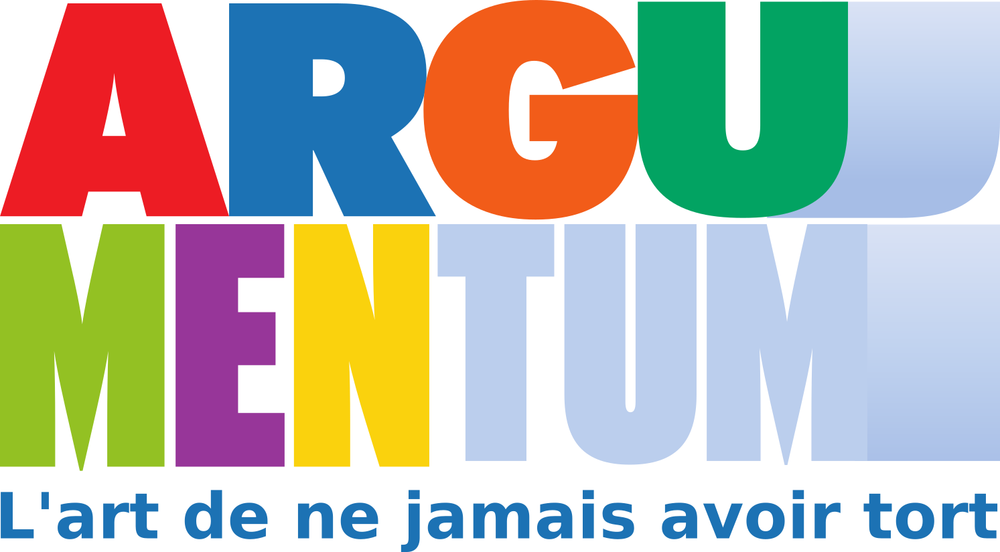

# Argumentum : du jeu de cartes au dépôt reproductible



*Illustration : `Cards/Rules/logo.png`, dépôt Argumentum, commit `33f25e82`.*

En avril 2024, Argumentum était un jeu de cartes prêt à imprimer. Aujourd’hui, c’est aussi un dépôt public dont chaque carte se reconstruit à partir de fichiers texte, en huit langues, avec ses cartes mentales et son ontologie.

## Le jeu

Argumentum est un jeu de cartes sur les sophismes, ces raisonnements qui paraissent valables sans l’être. Une carte décrit un sophisme, donne sa définition et un exemple. On apprend à le reconnaître, puis à lui opposer l’argument qui tient.

Le jeu se joue avec trois paquets. Le premier réunit les grandes cartes : les sophismes, les règles et une carte mémo. Le second réunit les petites cartes : les scénarios, où il s’agit de reconnaître quel sophisme se cache dans une situation donnée. Le troisième, à part, décrit les vertus de l’argumentation : les arguments qui tiennent.

## Un point de référence, puis une reconstruction

Le dépôt existe depuis le 20 mars 2020.

Une version est longtemps restée la référence : le commit `0087f0ec`, du 25 avril 2024. C’est elle qui produisait le jeu complet. Entre 2025 et 2026, la chaîne de fabrication a été remise en état pièce par pièce, et surtout outillée : chaque étape a désormais son contrôle, et une modification qui casserait une carte ne passe plus inaperçue.

## Comment naît une carte

Quatre étapes, toutes à partir de fichiers texte.

**Les données.** Un fichier CSV par famille : la taxonomie des sophismes, celle des vertus, les scénarios, les règles. Une ligne par élément, et une colonne par langue. C’est le seul endroit où le texte d’une carte existe.

**Le gabarit.** Un fichier JSON qui contient le HTML et le CSS d’une carte, avec des trous à remplir. Le moteur de rendu, CardPen, remplit ces trous avec les données du CSV. Les trous s’écrivent entre doubles accolades : c’est la syntaxe des gabarits Handlebars, un système qui remplace des étiquettes par des valeurs.

**L’image.** Un navigateur piloté ouvre le gabarit rempli et capture la carte en image PNG, à la résolution de l’impression.

**Le document.** Une bibliothèque, QuestPDF, assemble les pages : recto et verso, repères de découpe, et, pour la version à imprimer chez soi, plusieurs cartes par feuille A4.

## Ce qui s’est ajouté

**Huit langues.** Français, anglais, russe, portugais, espagnol, arabe, persan et chinois. Deux d’entre elles, l’arabe et le persan, s’écrivent de droite à gauche, avec une police dédiée à leur alphabet.

**Les cartes mentales.** La taxonomie entière dessinée en arbre, une par langue, exportée en SVG — un format d’image vectorielle, qui reste net à n’importe quelle taille. Des pages HTML du dépôt les affichent.

**L’ontologie.** Deux fichiers OWL, l’un pour les sophismes, l’autre pour les vertus. Une ontologie est une description formelle des concepts et de leurs relations, écrite pour être lue par une machine : elle permet à un logiciel de savoir qu’un sophisme appartient à une famille, qu’il a des variantes, et comment il se relie aux autres. La taxonomie s’y retrouve aussi décrite dans SKOS, un vocabulaire standard pour publier un thésaurus.

**Le Print & Play.** En plus des fichiers destinés à un imprimeur, le dépôt produit des pages A4 à imprimer chez soi, découper et jouer.

## Ce que contient la boîte

| Élément | Cartes |
|---|---:|
| Sophismes | 175 |
| Règles | 15 |
| Mémo | 1, imprimée en 7 exemplaires |
| Scénarios | 167 |
| Vertus argumentatives (paquet à part) | 131 |

Deux remarques pour lire ce tableau. Les sophismes sont 175 à porter une carte, mais la taxonomie décrit 1 408 nœuds : elle descend des grandes familles jusqu’aux cas particuliers, et tous ne méritent pas une carte. Les vertus suivent la même règle.

Le paquet de tarot réunit donc 197 cartes à fabriquer. Avec les 167 scénarios, la boîte en compte 364. Elle en compte 495 si l’on y ajoute les vertus.

Ces chiffres sont comptés sur les fichiers CSV du dépôt, par la même règle que le contrôle automatique qui revérifie ce compte à chaque modification.

## Comment on s’assure que rien ne casse

Les contrôles ne recopient pas les chiffres : ils les recalculent, puis les confrontent à ce qui a été produit.

Le nombre de cartes d’un paquet se déduit de la configuration et des CSV. Une ligne perdue dans un fichier de données fait donc échouer la vérification, au lieu de produire un jeu silencieusement incomplet.

La taille des pages est mesurée sur les PDF eux-mêmes, avec une tolérance d’un millimètre : un document composé au mauvais format est signalé même quand son nombre de pages est juste.

Les cartes mentales ont leurs liens vérifiés un par un, et leurs pages d’affichage ne doivent pas être plus anciennes que le dessin qu’elles contiennent — sinon la page montre une version périmée de l’arbre.

Un dernier contrôle ouvre le paquet et lit ses premières pages pour vérifier que les règles y figurent, dans l’ordre. Il ne peut pas lire de texte : ces pages sont des images. Il compare donc les pixels des premières pages à ceux des cartes de règles.

Ceux de ces contrôles qui ne lisent que le dépôt s’exécutent à chaque modification proposée : le compte des cartes, les liens des cartes mentales, et les témoins des contrôles sur PDF, qui éprouvent leur logique sur des cas construits pour l’épreuve. Les contrôles qui ouvrent les PDF produits, eux, tournent sur une machine qui vient de régénérer le jeu : une fabrication complète demande des heures, on ne la rejoue pas à chaque modification.

## Tout est ouvert

Le code est publié sous licence LGPL-3.0 : on peut le lire, le modifier, et le réutiliser, à condition que les modifications du code lui-même restent sous la même licence.

Le corpus éditorial — les textes des cartes — est sous licence Creative Commons BY-SA 4.0, qui autorise la réutilisation et l’adaptation à condition de créditer et de partager à l’identique. Cette licence ne couvre pas tout le dépôt : elle s’applique aux sept fichiers énumérés dans le fichier `LICENSE-CONTENT.md`, et à eux seuls — les cinq fichiers de texte des cartes et les deux ontologies qui en dérivent. Pour tout autre fichier, c’est la licence du code qui s’applique.

Reconstruire le jeu se fait en une commande, depuis la racine du dépôt :

```bash
dotnet run --project Generation/Converters/Argumentum.AssetConverter/Argumentum.AssetConverter.csproj
```

Les PDF sont écrits dans le dossier de sortie du projet, un sous-dossier par langue. Il faut pour cela un environnement .NET, et le moteur de rendu des cartes servi par un site web local ; les cartes mentales demandent en outre FreeMind, le logiciel qui les dessine.

## Et maintenant

Le dépôt continue d’avancer : la taxonomie se complète, les traductions se relisent, et les contrôles s’étendent à mesure que de nouveaux défauts sont trouvés. Chaque carte du jeu reste ainsi reproductible à partir de son texte, et vérifiable.

---

*Sources : dépôt [Argumentum](https://github.com/ArgumentumGames/Argumentum), commit `33f25e82` (6 novembre 2026). Comptes établis sur [`Cards/Fallacies/Argumentum Fallacies - Taxonomy.csv`](https://github.com/ArgumentumGames/Argumentum/blob/33f25e82/Cards/Fallacies/Argumentum%20Fallacies%20-%20Taxonomy.csv), la taxonomie des vertus, `Cards/Scenarii/Argumentum Scenarii - Cards.csv` et `Cards/Rules/Argumentum Rules - Cards.csv`. Licences : [`LICENSE`](https://github.com/ArgumentumGames/Argumentum/blob/master/LICENSE) et [`LICENSE-CONTENT.md`](https://github.com/ArgumentumGames/Argumentum/blob/master/LICENSE-CONTENT.md). Cartes mentales : [dossier `Cards/Fallacies/Mindmaps`](https://github.com/ArgumentumGames/Argumentum/tree/33f25e82/Cards/Fallacies/Mindmaps). Ontologie : [`docs/ontology/argumentum.owl`](https://github.com/ArgumentumGames/Argumentum/blob/33f25e82/docs/ontology/argumentum.owl).*
