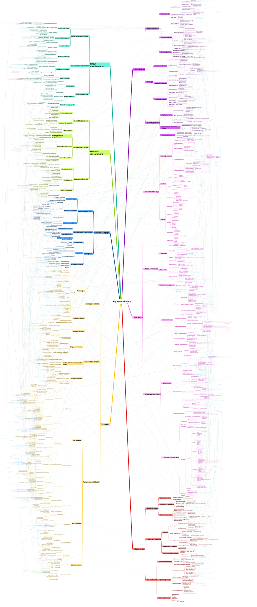

# Chaque sophisme à sa place : l’ontologie d’Argumentum et le format AIF

*Illustration : `Cards/Fallacies/Mindmaps/fr/Fallacies_fr.links.svg`, dépôt Argumentum, commit `32408fdd` — chaque trait coloré relie deux sophismes que le corpus déclare apparentés.*

Une carte du jeu décrit un sophisme à la fois ; l’ontologie du dépôt les décrit tous ensemble, avec leurs parentés et leurs liens. Sa notation reprend le format de référence AIF, et le geste qu’AIF ne fait que sur une poignée de sophismes, Argumentum l’étend à son arbre entier.

## Une description lisible par les machines

Une ontologie est une description formelle des concepts d’un domaine et de leurs relations, écrite pour être lue par un programme plutôt que par un œil. Argumentum en publie deux, dans le langage OWL du web sémantique : l’un pour les 1 408 nœuds de la taxonomie des sophismes, l’autre pour les 223 nœuds des vertus. Chaque nœud y porte un identifiant stable, un libellé en français et en anglais, et sa place dans la hiérarchie — écrite dans SKOS, le vocabulaire standard pour publier des thésaurus. Les huit langues du jeu vivent dans les cartes et les cartes mentales ; l’ontologie, elle, reste volontairement bilingue.

Les deux fichiers sont publiés en ligne, et le canal de publication les ressert à chaque mise à jour du dépôt.

## Le sophisme, exception à un schème

AIF — Argument Interchange Format — est le format de référence issu de la recherche sur l’argumentation artificielle pour écrire un argument, l’inférence qui le produit, et les conflits qui l’attaquent. Il s’appuie sur les schèmes d’argumentation dressés par Douglas Walton : un schème est une forme d’argument légitime — l’expertise, l’analogie, les conséquences — accompagnée de ses questions critiques, celles dont la réponse sépare l’usage honnête du détournement.

Un sophisme, dans ce cadre, est une exception à un schème : il imite une forme valable et saute la question qui l’aurait fait tomber. AIF et Walton font ce geste sur une poignée de sophismes ; Argumentum l’applique à son arbre, nœud par nœud, en décrivant pour chacun le schème légitime qu’il imite, ce que son attaque vise, et la question critique qu’il saute.

Mesuré sur le corpus du dépôt : 1 064 nœuds sur 1 408 ont leur schème imité, 1 400 leur cible d’attaque, 1 212 leur question critique. Le sophisme, le plus souvent, ne contredit pas une conclusion : il s’en prend à ce qui y mène, la règle d’inférence qui la produit.

## La question posée au plus haut nœud

La taxonomie descend jusqu’à dix niveaux, et la mécanique d’un nœud vaut souvent pour toute sa descendance. La question critique se pose donc au nœud le plus haut où elle est vraie, et les descendants l’héritent. Douze questions écrites à ce jour couvrent ainsi des groupes entiers : « Raisonnement biaisé », 257 nœuds, l’est par dix questions posées à sa tête, à ses trois enfants et à six de ses petits-enfants ; « Procédé rhétorique » le devient par deux, dont celle-ci, posée au nœud « Humour » :

> Le rire a-t-il établi quelque chose sur le fond, ou a-t-il seulement évité d’y répondre ?

Chaque question vit dans le corpus, et le générateur de l’ontologie sait l’écrire à côté de son nœud. Le chantier avance groupe par groupe.

## Les liens transverses, tracés sur la carte

Le corpus dit aussi comment les sophismes se répondent, par huit relations : s’appuyer sur un autre, le dénoncer, le permettre, s’y opposer, l’inverser, le refléter, le précéder, lui être apparenté. 487 sophismes sur 1 408 portent au moins un de ces liens.

Chaque langue a sa carte mentale de l’arbre entier ; sa variante « liens » trace chaque relation en couleur, une teinte par verbe. La carte française porte exactement ses 581 flèches, comptées à l’unité près. Rendre chaque flèche cliquable — voir où elle mène, et pourquoi elle existe — est le chantier suivant.

## Les vertus, et un export pour les programmes

Le paquet des vertus a reçu le même traitement, avec sa différence : une vertu ne détourne rien, elle tient. Le corpus la relie donc au bon argument qu’elle incarne : 222 liens de bonne tenue vers 14 schèmes légitimes.

Le tout est aussi exporté en fichiers CSV simples à consommer pour un programme : les 145 arêtes d’attaque des sophismes, les fichiers des vertus, l’arbre de la taxonomie, et le graphe des relations entre sophismes, chaque lien symétrique y étant écrit dans les deux sens. Le projet d’enseignement CoursIA, public, s’en sert pour sa série d’analyse argumentative.

## Où les trouver

- les deux ontologies, publiées en ligne : [sophismes](https://argumentumgames.github.io/Argumentum/docs/ontology/argumentum.owl) et [vertus](https://argumentumgames.github.io/Argumentum/docs/ontology/argumentum_virtues.owl) ;
- la carte mentale de chaque langue et sa variante « liens » : [dossier `Cards/Fallacies/Mindmaps`](https://github.com/ArgumentumGames/Argumentum/tree/32408fdd/Cards/Fallacies/Mindmaps) du dépôt ;
- les exports CSV, avec leur documentation : [dossier `docs/ontology/aif-export`](https://github.com/ArgumentumGames/Argumentum/tree/32408fdd/docs/ontology/aif-export).

---

*Sources : dépôt [Argumentum](https://github.com/ArgumentumGames/Argumentum), commit `32408fdd`. Comptes établis le 8 novembre 2026 sur [`Cards/Fallacies/Argumentum Fallacies - Taxonomy.csv`](https://github.com/ArgumentumGames/Argumentum/blob/32408fdd/Cards/Fallacies/Argumentum%20Fallacies%20-%20Taxonomy.csv) et les fichiers publiés du dossier `docs/ontology/` (ontologies et exports, liens vérifiés). Modélisation AIF et export du graphe d’attaques : [`docs/ontology/aif-export/README.md`](https://github.com/ArgumentumGames/Argumentum/blob/32408fdd/docs/ontology/aif-export/README.md). Question critique citée verbatim (nœud « Humour », chemin 2.1.2). Consommateur cité : dépôt [CoursIA](https://github.com/jsboige/CoursIA).*
