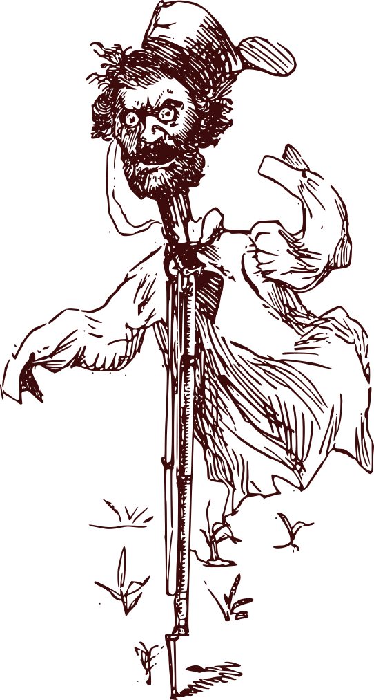

# La descente guidée dans l’arbre : le plugin Argumentum du projet Epita

*Illustration : `Cards/Fallacies/Assets/Fallacy-front/7.3.1.2.png`, dépôt Argumentum, commit `32408fdd` — l’illustration de face du nœud « Homme de paille », but de l’exemple de descente ci-dessous.*

Le projet d’intelligence symbolique d’Epita, édition 2025, a construit un système d’agents qui analyse un texte argumentatif. Son plugin Argumentum y détecte les sophismes en descendant la taxonomie du jeu niveau par niveau, au lieu de choisir d’un coup parmi plus de mille étiquettes. La forme de l’arbre fait que chaque pas ne propose que quelques branches — et la réponse arrive avec le chemin qui y mène.

## Le projet

C’est un dépôt public : des agents logiciels — analyse, logique, détection de sophismes — y sont orchestrés par Semantic Kernel, un cadre qui permet à un modèle de langue d’appeler des outils, et s’appuient sur un moteur de raisonnement formel écrit en Java. La plateforme est pédagogique : chaque brique y est un exercice d’architecture d’intelligence artificielle symbolique, où manipuler des symboles et des règles plutôt que des statistiques.

## Mille quatre cent huit étiquettes

La taxonomie des sophismes d’Argumentum compte 1 408 nœuds, du nœud racine aux cas particuliers, jusqu’à dix niveaux de profondeur. Demander à un modèle « quel est ce sophisme ? » devant la liste entière, c’est lui faire tirer une étiquette parmi plus de mille, sans structure pour guider le choix.

Or la forme de l’arbre dit autre chose : chaque nœud y a au plus 9 enfants, et la moitié des nœuds qui en ont n’en ont pas plus de deux. Un choix guidé par la structure remplace le pari.

## La descente, pas à pas

Le plugin charge la taxonomie en CSV, le format du dépôt du jeu. À chaque étape, il montre au modèle le nœud courant et deux niveaux de sa descendance ; le modèle confirme le nœud — c’est ici — ou demande à descendre vers un enfant, parfois en sautant un niveau. Chaque pas coûte un appel au modèle. Une confirmation trop haut dans l’arbre est refusée : à moins de deux niveaux de profondeur, l’étiquette est trop générale pour être une réponse.

Un exemple, construit sur une carte du jeu (aucun texte analysé n’est montré ici). La carte « Homme de paille » vit au chemin 7.3.1.2 : Obstruction, puis Ad hominem, puis Procès en incohérence, puis Homme de paille. Une descente qui l’atteint ressemble à ceci : le texte cherche à disqualifier l’adversaire plutôt qu’à lui répondre — descendre vers Obstruction ; il vise la personne — descendre vers Ad hominem ; il lui reproche de s’être contredit — descendre vers Procès en incohérence ; l’objet même de l’attaque est déformé — confirmer Homme de paille. Quatre pas, chacun parmi peu d’enfants.

## Ce qui borne la descente

Il n’y a pas de plafond de profondeur : les feuilles de l’arbre sont le seul plafond, et l’agent peut descendre jusqu’à elles. La garantie contre l’emballement est un budget d’appels au modèle : 18 par branche, et 240 pour toute une analyse, par défaut. La descente commence par un large filet qui retient des candidats, dont quatre branches au plus descendent en parallèle ; à un embranchement, si plusieurs enfants semblent prometteurs, les suivants sont explorés en parallèle, dans la limite de douze sous-branches. Quand une branche confirme un nœud profond, ses sœurs qui exploraient un ancêtre abandonnent : la réponse la plus spécifique gagne. Et si la descente échoue, le plugin ne renonce pas — il retente le choix en un coup, sans guidance.

## La trace

Chaque descente laisse sa trace de navigation : le chemin suivi, les confirmations, les abandons. La réponse est explicable par son itinéraire — le système peut montrer pourquoi il a proposé ce nœud plutôt qu’un autre. Sur une taxonomie profonde, c’est peut-être le principal produit de la méthode : non seulement une étiquette, mais la raison du trajet.

## Après le projet

L’entonnoir taxonomique a été repris tel quel dans CoursIA, un dépôt public de supports de cours en intelligence artificielle, qui l’intègre à sa série d’analyse argumentative. L’orchestration d’agents à plugins, elle, y est encore en chantier.

---

*Sources : dépôt [Argumentum](https://github.com/ArgumentumGames/Argumentum), commit `32408fdd` (comptes établis le 8 novembre 2026 sur [`Cards/Fallacies/Argumentum Fallacies - Taxonomy.csv`](https://github.com/ArgumentumGames/Argumentum/blob/32408fdd/Cards/Fallacies/Argumentum%20Fallacies%20-%20Taxonomy.csv), colonne des chemins). Dépôt [Epita 2025](https://github.com/jsboigeEpita/2025-Epita-Intelligence-Symbolique), épinglé au commit [`acaf670e9`](https://github.com/jsboigeEpita/2025-Epita-Intelligence-Symbolique/blob/acaf670e9a/argumentation_analysis/plugins/fallacy_workflow_plugin.py) (6 novembre 2026) : [`fallacy_workflow_plugin.py`](https://github.com/jsboigeEpita/2025-Epita-Intelligence-Symbolique/blob/acaf670e9a/argumentation_analysis/plugins/fallacy_workflow_plugin.py) et [`taxonomy_navigator.py`](https://github.com/jsboigeEpita/2025-Epita-Intelligence-Symbolique/blob/acaf670e9a/argumentation_analysis/agents/utils/taxonomy_navigator.py) — budgets et mécaniques cités d’après ces fichiers. Reprise dans CoursIA : [issue #19287](https://github.com/jsboige/CoursIA/issues/19287) (faite) et [issue #18390](https://github.com/jsboige/CoursIA/issues/18390) (en cours).*
