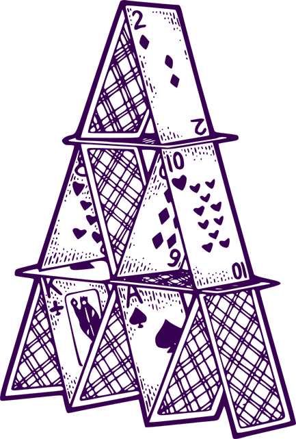

# Des carnets de cours lisent le jeu : Argumentum dans CoursIA

*Illustration : `Cards/Fallacies/Assets/Virtues-front/1.1.1.png`, dépôt Argumentum, commit `32408fdd` — la carte « Argument réel », du paquet des vertus que parcourt l’un des carnets décrits ici.*

CoursIA, un dépôt public de supports de cours en intelligence artificielle, consacre une série de carnets à l’analyse argumentative. Cinq d’entre eux prennent le corpus d’Argumentum pour terrain — taxonomie, ontologie, liens transverses, vertus — sur une version du dépôt du jeu expressément figée pour eux.

## Le dépôt et sa série

Un carnet Jupyter est un document qui mêle texte et code exécutable pas à pas : chaque étape s’affiche, se modifie et se rejoue. La série s’appelle Argument_Analysis — « analyse argumentative » — et compte 38 carnets, du modèle de Toulmin, qui décompose un argument en ses éléments, jusqu’aux sémantiques de Dung, les mathématiques qui disent quels arguments d’un débat restent debout.

Sa méthode est documentée : un modèle de langue extrait d’un texte son tissu argumentatif — prémisses, conclusions, transitions — ; un solveur SAT, un programme qui décide si des formules logiques peuvent être satisfaites ensemble, vérifie la cohérence de la formalisation ; une couche d’orchestration assemble le tout en pipeline reproductible.

## Une version figée, pour rejouer

Argumentum y entre comme sous-module : une référence inscrite dans le dépôt de CoursIA qui désigne le dépôt du jeu à un commit précis. L’épingle pointe le commit du 5 novembre 2026. C’est ce qui garantit qu’un carnet écrit aujourd’hui s’exécutera demain sur le même corpus : les taxonomies ne bougent pas sous les pieds de l’enseignant, et chaque mesure datée reste rejouable.

## Les carnets qui lisent le jeu

Cinq carnets consomment le corpus directement :

- [**La détection**](https://github.com/jsboige/CoursIA/blob/7eea21ebefe/MyIA.AI.Notebooks/SymbolicAI/Argument_Analysis/Argumentation-02-Fallacies-Detection-Python.ipynb) — la taxonomie des sophismes sert de référence au détecteur : chaque étiquette connue est un nœud de l’arbre.
- [**Les cartes**](https://github.com/jsboige/CoursIA/blob/7eea21ebefe/MyIA.AI.Notebooks/SymbolicAI/Argument_Analysis/Argumentation-02b-Argumentum-Cards-Python.ipynb) — le deck du jeu se dérive de la taxonomie : du nœud de l’arbre à la carte jouable, en passant par les illustrations.
- [**L’ontologie des sophismes**](https://github.com/jsboige/CoursIA/blob/7eea21ebefe/MyIA.AI.Notebooks/SymbolicAI/Argument_Analysis/Argumentation-Onto-01-AIF-OWL2-Python.ipynb) — il lit `argumentum_fallacies.owl`, l’export formel de la taxonomie. Les bibliothèques de lecture standard, rdflib et owlready2, échouent sur ce format : le carnet construit donc son propre parseur tolérant, et documente cette fragilité comme celle du pont, pas du fichier.
- [**Les liens transverses**](https://github.com/jsboige/CoursIA/blob/7eea21ebefe/MyIA.AI.Notebooks/SymbolicAI/Argument_Analysis/Argumentation-Onto-02-CrossLinks-CSV-Python.ipynb) — lui lit le CSV canonique, avec ses huit colonnes de relations entre sophismes et ses alignements vers les schèmes d’argumentation de Walton, une typologie classique des raisonnements présomptifs. Il recense 116 alignements, et mesure la concordance entre CSV et ontologie à l’épingle : sur 145 relations d’attaque et 116 alignements, elle est totale.
- [**Les vertus**](https://github.com/jsboige/CoursIA/blob/7eea21ebefe/MyIA.AI.Notebooks/SymbolicAI/Argument_Analysis/Argumentation-Onto-03-Vertus-SKOS-Python.ipynb) — lui ouvre `argumentum_virtues.owl`, le pôle positif du jeu, comme un thésaurus SKOS, un vocabulaire standard pour publier des classifications : 2 897 triplets, racine « Argument valable ».

## Ce que la lecture révèle

Ces carnets ne se contentent pas de consommer : ils mesurent, et leurs mesures apprennent des choses au corpus lui-même. Première leçon, chiffrée par le carnet des liens transverses : l’effort de curation du jeu porte sur l’arbre — huit langues, sept familles, dix niveaux — bien plus que sur les liens entre ses branches, dont la densité est mesurée à 4,79 %. Le graphe au-dessus de l’arbre reste largement à écrire. Seconde leçon, consignée comme un écart à réconcilier : deux fichiers d’ontologie coexistent dans les lectures — l’un local à la série, l’autre celui du sous-module épinglé — et ils ne portent pas la même couche de liens transverses. C’est la contrepartie d’un corpus vivant : à chaque épingle ses états, et les carnets les datent.

## La circulation dans les deux sens

Le chemin ne va pas que du jeu vers les cours. Trois outils nés dans le dépôt du jeu — un adaptateur d’ontologie, un moteur de comparaison de fichiers CSV pour la synchronisation avec un tableur, et le jeu de prompts qui pilote la traduction des corpus — ont été remontés dans CoursIA comme supports d’exercice. Le suivi de l’ensemble est public et ouvert ; la série, elle, se déclare en maturité « bêta » pour 36 de ses 38 carnets. Du cours vivant, en somme — qui apprend autant du corpus qu’il lui enseigne.

---

*Sources : dépôt [CoursIA](https://github.com/jsboige/CoursIA), commit [`7eea21eb`](https://github.com/jsboige/CoursIA/tree/7eea21ebefe/MyIA.AI.Notebooks/SymbolicAI/Argument_Analysis) (8 novembre 2026) : [descriptif de la série](https://github.com/jsboige/CoursIA/blob/7eea21ebefe/MyIA.AI.Notebooks/SymbolicAI/Argument_Analysis/README.md), [déclaration du sous-module](https://github.com/jsboige/CoursIA/blob/7eea21ebefe/.gitmodules) et les cinq carnets liés ci-dessus — les comptes qu’ils établissent (116 alignements, 145/145, 2 897 triplets, 4,79 %, 38 carnets dont 36 en « bêta ») sont lus à ce commit. Sous-module Argumentum épinglé au commit `4332d26a` (5 novembre 2026). Illustration : dépôt [Argumentum](https://github.com/ArgumentumGames/Argumentum), commit `32408fdd`. Suivi : [Epic CoursIA #4960](https://github.com/jsboige/CoursIA/issues/4960).*
