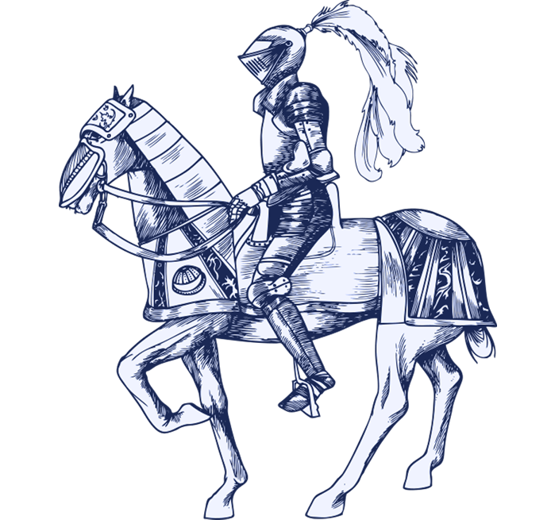

# Sophismes × scénarios : le jeu comme jeu de données

*Illustration : `Cards/Scenarii/Assets/Scenario-back/img-histoire.png`, dépôt Argumentum, commit `6da19683` — un dos par thème, sept thèmes pour 167 scénarios.*

Tirer un scénario, jouer une carte de sophisme : chaque manche d’Argumentum combine les deux, et chaque combinaison est une consigne dont on connaît d’avance la réponse. La série « détection de sophismes » du projet CoursIA en fait un générateur d’exemples annotés qui couvre l’arbre de la taxonomie entier — une couverture que, selon la documentation de la série, aucun corpus de textes naturels ne donne.

## Un tour de jeu, une consigne

Le paquet de scénarios décrit 167 situations, réparties en sept thèmes — histoire, mythologie, politique, pop culture, relation intime, vie personnelle, vie professionnelle — identifiables au dos des cartes. Les règles le résument ainsi, sur la carte « Le moulin à baratin » :

> À chaque manche, à partir d’un scénario tiré au sort, l’un des joueurs trouve, en un temps limité, le plus grand nombre d’arguments fallacieux illustrant les cartes piochées successivement.

Dans cette variante, le scénario reste et la carte change : chaque carte piochée demande un argument nouveau — fallacieux, et fallacieux *de cette sorte-là*. Le joueur qui tente de défendre un scénario avec le sophisme tiré fabrique, sans le savoir, un exemple étiqueté : la situation est le texte, la carte est l’étiquette.

C’est exactement la forme d’un jeu de données d’apprentissage pour un classifieur, un programme qui range un texte dans une catégorie : des textes, chacun portant l’étiquette de la catégorie à laquelle il appartient.

## Deux échelles

La première échelle est celle de la boîte. Les scénarios sont 167, les cartes de sophismes 175 : la partie offre donc 29 225 consignes jouables, toutes différentes.

La seconde échelle est celle de l’arbre. La taxonomie décrit 1 408 nœuds — des grandes familles jusqu’aux cas particuliers — dont 175 seulement portent une carte : tous ne méritent pas un exemplaire imprimé. Une carte mentale par langue dessine cet arbre entier. Chaque scénario se croise avec chaque nœud de l’arbre, et l’étiquette de chaque couple est connue d’avance ; l’opération qui énumère « chaque élément d’un côté avec chaque élément de l’autre » est ce que les mathématiciens appellent un produit cartésien.

CoursIA ne s’arrête pas aux sophismes : il croise aussi les nœuds de vertus argumentatives. Chaque couple est un exemple dont l’étiquette — le nœud — est connue par construction : la génération de l’étiquette est triviale, c’est le second facteur du couple.

## Pourquoi les vertus

Dans le produit cartésien, chaque couple (scénario, nœud de sophisme) porte une étiquette de sophisme : la table tirée des seuls nœuds de sophismes ne contient, par construction, aucun exemple d’argument qui tient.

Or un classifieur qui ne verrait que des sophismes ne pourrait pas apprendre ce qu’est un raisonnement sain : il saurait nommer les maladies sans avoir jamais vu un patient en bonne santé. Ce rôle revient au paquet des vertus — les arguments pertinents, la présentation intègre, la justesse lexicale… — et la documentation de la série le dit ainsi : les vertus donnent au classifieur la classe « argument sain », sans laquelle il ne verrait que des sophismes.

## Ce qu’en fait CoursIA

Le projet CoursIA (dépôt public) consacre une série de carnets à la détection des sophismes — le « Fallacy Detector ». Un carnet Jupyter est un document qui mêle texte et code exécutable pas à pas ; chaque étape y montre et se laisse rejouer. Le carnet de construction du jeu de données, accompagné d’un script dédié, énumère les 272 043 couples puis en tire trois jeux (mesures sur le dépôt CoursIA épinglé au commit `7eea21eb`, le 7 novembre 2026) :

| Jeu | Lignes | Couverture |
|---|---:|---|
| Apprentissage | 14 000 | 12 000 sophismes, 2 000 vertus |
| Validation | 1 629 | un couple par nœud |
| Test | 3 258 | deux couples par nœud |

Le découpage suit une règle anti-fuite : les trois jeux utilisent des scénarios distincts. Sans cela, un modèle pourrait reconnaître *la situation* plutôt que *le raisonnement* : il apprendrait le scénario, pas le sophisme. La validation sert à régler sans toucher au test ; le test mesure, à la fin seulement, sur du jamais vu.

Chaque tirage est reproductible : la graine du générateur aléatoire, les budgets et les proportions sont consignés dans un manifeste, avec l’empreinte des fichiers sources — les CSV d’Argumentum y sont identifiés par leur empreinte SHA-1, et le jeu d’apprentissage régénérable par une empreinte SHA-256. La copie des scénarios embarquée dans CoursIA est déposée avec sa licence et son attribution : les textes du corpus restent sous Creative Commons BY-SA 4.0, crédités « Argumentum ».

## Ce qui reste à prouver

Le couple (scénario, nœud) donne l’étiquette, pas le texte : il reste à écrire l’argument qui illustre chaque consigne. Ce travail est prévu par génération à partir d’un modèle de langue — il faut le dire tel quel. Au commit cité, cette génération et le test humain qui doit la contrôler sont explicitement « à venir ». Les garde-fous annoncés reprennent ceux du jeu — plusieurs votes, comme plusieurs joueurs jugent un argument — et un test par des humains extérieurs au projet.

Aucune performance de détection n’est avancée ici : il n’existe pas encore de mesure publiée, et rien n’est annoncé comme acquis. Ce qui est acquis, en revanche, c’est la structure : pour chaque nœud de l’arbre, dans chaque jeu, des consignes dont la réponse est certaine — et le chemin qui relie un tirage de cartes à un corpus vérifiable.

---

*Sources : dépôt [Argumentum](https://github.com/ArgumentumGames/Argumentum), commit `6da19683` (comptes sur [`Cards/Scenarii/Argumentum Scenarii - Cards.csv`](https://github.com/ArgumentumGames/Argumentum/blob/6da19683/Cards/Scenarii/Argumentum%20Scenarii%20-%20Cards.csv), [`Cards/Fallacies/Argumentum Fallacies - Taxonomy.csv`](https://github.com/ArgumentumGames/Argumentum/blob/6da19683/Cards/Fallacies/Argumentum%20Fallacies%20-%20Taxonomy.csv), la taxonomie des vertus et [`Cards/Rules/Argumentum Rules - Cards.csv`](https://github.com/ArgumentumGames/Argumentum/blob/6da19683/Cards/Rules/Argumentum%20Rules%20-%20Cards.csv), le 7 novembre 2026). Dépôt [CoursIA](https://github.com/jsboige/CoursIA), commit [`7eea21eb`](https://github.com/jsboige/CoursIA/tree/7eea21ebefe/MyIA.AI.Notebooks/GenAI/FallacyDetection) : [README de la série](https://github.com/jsboige/CoursIA/blob/7eea21ebefe/MyIA.AI.Notebooks/GenAI/FallacyDetection/README.md), [script de construction](https://github.com/jsboige/CoursIA/blob/7eea21ebefe/scripts/fallacy_detection/cartesian_dataset_builder.py) et [manifeste des splits](https://github.com/jsboige/CoursIA/blob/7eea21ebefe/MyIA.AI.Notebooks/GenAI/FallacyDetection/data/phase2/manifest.json). Suivi : [Epic CoursIA #10355](https://github.com/jsboige/CoursIA/issues/10355), test humain externe [CoursIA #17578](https://github.com/jsboige/CoursIA/issues/17578).*
