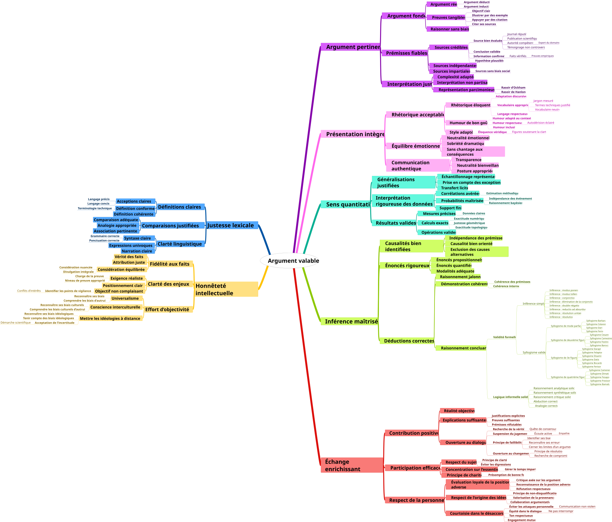

# La dette d’irréversibilité du discours : une prédiction posée sur le corpus d’Argumentum

*Illustration : `Cards/Fallacies/Mindmaps/fr/Argumentum_Virtues_MindMap_fr.links.svg`, dépôt Argumentum, commit `32408fdd` — la carte des vertus de l’argumentation et les liens qui relient ses nœuds : un graphe, matière première de la strate décrite ici.*

Une série de recherche de CoursIA, ICT — « trajectoires causales intégrées » —, étudie comment des structures s’organisent, se transforment et se réparent le long du temps. Sa sixième strate prend le discours pour matière, et elle a posé à l’avance la prédiction qui devra la faire échouer ou tenir : une « dette d’irréversibilité du discours », que le corpus d’Argumentum sera chargé de mesurer.

## Le discours comme substrat

La série progresse en sept strates, du tri auto-organisé de cellules jusqu’à des degrés de liberté d’ordre supérieur, et son descriptif résume la sixième d’une phrase : savoir si une structure causale se maintient quand ce qui circule n’est plus de la matière ni des poids, mais des raisons. Le substrat est le discours : des trajectoires de croyance sur des graphes d’arguments — l’objet même que le philosophe Phan Minh Dung a formalisé en 1995, des arguments dont les uns en attaquent d’autres.

## Une prédiction posée avant la mesure

La strate ne commence pas par une conclusion mais par un pari consigné : les régimes rhétoriques manipulatoires laisseraient une trace mesurable — une structure d’arguments qui se maintient pendant que la trajectoire de croyance s’appauvrit, comme une dette que le discours paie en irréversibilité. Poser la prédiction avant l’expérience est ce qui la rend falsifiable : le descriptif de la série le dit lui-même, cette prédiction est posée et « pas encore mesurée ». Un résultat négatif sera un résultat.

## La graine exécutée

La strate est « cadrée et non livrée », mais sa graine est exécutée : trois carnets — des documents mêlant texte et code exécutable — et leur capstone.

[**Trajectoires de croyance**](https://github.com/jsboige/CoursIA/blob/7eea21ebefe/MyIA.AI.Notebooks/IIT/ICT-Series/ICT-Argumentation-BeliefTrajectories-Python.ipynb) applique l’instrumentation de la série à des trajectoires argumentatives sur des régimes synthétiques, un anneau délibératif et une cascade populiste. Son constat est sans détour : le corpus réel d’Argumentum n’y est pas mesuré, la transposition reste ouverte.

[**Acceptabilité lue comme formules quantifiées**](https://github.com/jsboige/CoursIA/blob/7eea21ebefe/MyIA.AI.Notebooks/IIT/ICT-Series/ICT-Argumentation-QBFAcceptance-Python.ipynb) relit les deux verdicts classiques des graphes d’attaques — crédule, sceptique — comme des formules booléennes quantifiées, où alternent des « pour tout » et des « il existe » : être crédule, c’est chercher un témoin ; être sceptique, c’est exiger que tout résiste.

[**Maintenance de la vérité**](https://github.com/jsboige/CoursIA/blob/7eea21ebefe/MyIA.AI.Notebooks/IIT/ICT-Series/ICT-Argumentation-TruthMaintenance-Python.ipynb) ajoute la couche de révision : deux moteurs classiques, JTMS et ATMS — des systèmes qui retirent les conséquences d’une prémisse abrogée —, portés du projet Epita avec une preuve de fidélité ligne à ligne, puis un pont vers la sémantique du graphe d’attaques.

Le [**capstone**](https://github.com/jsboige/CoursIA/blob/7eea21ebefe/MyIA.AI.Notebooks/IIT/ICT-Series/ICT-Argumentation-Capstone-Python.ipynb) consomme les trois sans les recopier. Celui qui doit mesurer la prédiction sur le corpus réel, lui, en est au stade de la note de conception.

## Ce que le jeu apporte

La matière réelle, c’est le corpus : la taxonomie des sophismes, 1 408 nœuds, son ontologie AIF — la description formelle des arguments et de leurs attaques — et l’export du graphe qui en dérive. Cet export existe : un script du dépôt du jeu produit, à partir des sources, 145 arêtes d’attaque typées, les relations entre sophismes, l’arbre, et côté vertus les liens de « bonne tenue ». Il dit aussi honnêtement sa limite : le graphe d’attaques est biparti — chaque sophisme pleinement modélisé attaque un type de nœud abstrait, pas un autre sophisme ; les relations entre sophismes vivent dans un graphe séparé, étiqueté comme tel.

## Le rôle du projet

Le propriétaire du jeu formule ce rôle d’un mot : le projet Argumentum comme intendant, avec Epita, de la distillation expérimentale. Concrètement, cela veut dire tenir le corpus de référence et ses versions épinglées — l’export daté ci-dessus nomme ses sources fichier par fichier — ; fournir les exports ; relire les carnets qui consomment ce corpus ; et faire passer dans CoursIA, avec le projet Epita, les mécanismes éprouvés — la maintenance de la vérité portée par le troisième carnet, l’entonnoir de descente dans l’arbre taxonomique.

## L’état, dit tel quel

La strate est cadrée, non livrée : la prédiction n’est pas mesurée, les deux jambes qui doivent l’encadrer — la morphogenèse rhétorique, la grammaire de propagation — ne sont pas livrées, et l’horizon qui les prolonge, vers l’altérité et la collaboration entre agents, reste conditionné. Rien ici n’est présenté comme obtenu. Ce qui existe : une prédiction pré-enregistrée, une graine exécutée sur des régimes synthétiques, et un corpus réel qui attend d’être mesuré.

---

*Sources : dépôt [CoursIA](https://github.com/jsboige/CoursIA), commit [`7eea21eb`](https://github.com/jsboige/CoursIA/tree/7eea21ebefe/MyIA.AI.Notebooks/IIT/ICT-Series) (8 novembre 2026) : [descriptif de la série ICT](https://github.com/jsboige/CoursIA/blob/7eea21ebefe/MyIA.AI.Notebooks/IIT/ICT-Series/README.md), les quatre carnets liés ci-dessus, et le suivi : graine [CoursIA #7289](https://github.com/jsboige/CoursIA/issues/7289) (faite), capstone sur corpus réel [CoursIA #23777](https://github.com/jsboige/CoursIA/issues/23777) (en conception), horizon [CoursIA #7291](https://github.com/jsboige/CoursIA/issues/7291). Dépôt [Argumentum](https://github.com/ArgumentumGames/Argumentum), commit `32408fdd` : [script d’export du graphe](https://github.com/ArgumentumGames/Argumentum/blob/32408fdd/tools/aif-attack-graph-export.py) et [dossier d’export](https://github.com/ArgumentumGames/Argumentum/tree/32408fdd/docs/ontology/aif-export) — comptes re-mesurés sur les fichiers committés le 8 novembre 2026.*
