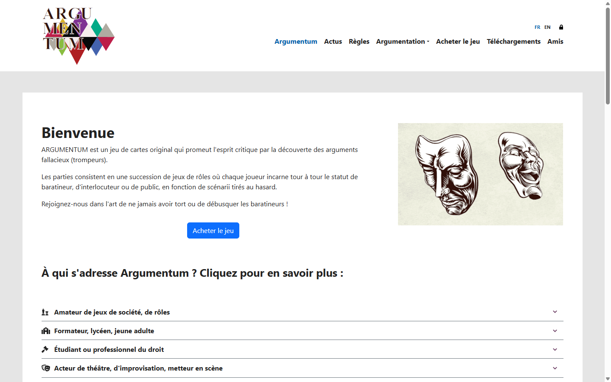

# Le site Argumentum, en huit langues

*Illustration : `docs/dnn-localization/preuves/i1-navbar-fr-1440.png`, dépôt Argumentum, commit `6da19683` — la barre de navigation du site, capturée lors des vérifications d’octobre 2026.*

Le site d’Argumentum paraît désormais en huit langues, du français au persan, et chaque page porte le même choix de langue. Les cartes mentales et l’ontologie de la taxonomie y ont leur place, dans la langue de lecture de chacun.

## Huit langues, un choix sur chaque page

Français, anglais, espagnol, portugais, russe, chinois, arabe et persan : huit langues, dont deux — l’arabe et le persan — s’écrivent de droite à gauche. Le sélecteur de langue, en tête du site, est le même sur toutes les pages : huit codes (FR, EN, ES, PT, RU, ZH, AR, FA), un clic, et la page change de langue entière — textes, menus, messages de l’interface.

Les pages d’accueil des huit langues répondent toutes, et la mise en page de la page arabe s’inverse bien de droite à gauche — vérifié sur la page servie elle-même, pas seulement dans les fichiers.

## Les mêmes pages dans chaque langue

La navigation ne change pas d’une langue à l’autre : Accueil, Actus, Règles, Argumentation, Acheter le jeu, Téléchargements, Amis. Mêmes pages, mêmes images, mêmes liens ; seuls les libellés changent. Les actualités du site, qui datent de 2022, sont servies dans les huit langues par la même mécanique.

## La carte mentale et l’ontologie

Sous le menu Argumentation, la carte mentale des sophismes est dessinée dans chaque langue : huit pages, une par langue, toutes vérifiées le même jour. Chacune dessine l’arbre entier de la taxonomie — des grandes familles aux cas particuliers — avec ses liens entre nœuds apparentés.

L’ontologie décrit la même taxonomie, cette fois pour être lue par une machine : un fichier OWL, c’est-à-dire une description formelle des concepts et de leurs relations, qui permet à un logiciel de savoir qu’un sophisme appartient à une famille et comment il se relie aux autres. Elle est publiée dans le dépôt, en deux fichiers — sophismes et vertus.

## Comment les huit langues ont été fabriquées

La traduction du site est documentée geste par geste dans le dépôt, avec ses preuves. Elle s’est faite en deux couches.

L’interface — menus, boutons, messages du système — utilise les paquets de langue de la plateforme, installés puis complétés clé par clé là où le paquet manquait.

Les contenus — titres, diaporama, actualités — ont été traduits par un modèle de langue, puis chaque traduction a été relue par un second modèle indépendant, qui peut la valider, la corriger ou la rejeter. Cette relecture attrape des défauts réels : un titre anglais avait recopié l’ordre des mots de la source française (« By category filtered news list ») ; la passe de relecture l’a rétabli dans l’ordre naturel de l’anglais (« News list filtered by category »). Les actualités de 2022 ont suivi la même double passe : traduites puis contre-relues.

Chaque geste laisse une preuve d’intégrité : l’outil qui écrit les traductions sait aussi relire le fichier et le reproduire à l’octet près — tout écart dans le fichier produit est donc attribuable aux seules cellules changées, et rien d’autre ne bouge.

La relecture humaine porte sur les textes français. Pour les sept autres langues, ce qui tient la traduction est la double passe des deux modèles ; aucune relecture native n’est revendiquée ici, parce qu’elle n’a pas eu lieu. Une traduction qui peut être améliorée est une traduction qu’on peut signaler — les corrections font partie de la vie du site.

## Les règles et les téléchargements

La page Règles existe dans chaque langue. La version 2.0 du jeu, annoncée le jour de la mise en ligne, apporte son livret de règles et ses fichiers à imprimer : ils seront proposés sur la page Téléchargements, avec une section par langue. Le jour de la mise en ligne, l’annonce du jeu paraît juste en dessous de cet article.

## Ce qui reste à venir

Trois travaux suivent la mise en ligne, dans l’ordre :

- les fiches complètes des règles sur la page Règles, importées après la mise en ligne ;
- la page Argumentation reliée langue par langue à la carte mentale et à l’ontologie ;
- la recherche et les liens cliquables dans la carte mentale.

Ces travaux se préparent dans le dépôt public, où chacun peut les suivre — et où chaque geste de traduction ou de correction laisse sa trace, avec sa preuve.

---

*Sources : dépôt [Argumentum](https://github.com/ArgumentumGames/Argumentum), commit `6da19683` — [cartes mentales](https://github.com/ArgumentumGames/Argumentum/tree/6da19683/Cards/Fallacies/Mindmaps), [ontologie des sophismes](https://github.com/ArgumentumGames/Argumentum/blob/6da19683/docs/ontology/argumentum.owl) et [ontologie des vertus](https://github.com/ArgumentumGames/Argumentum/blob/6da19683/docs/ontology/argumentum_virtues.owl), [dossier des gestes de localisation](https://github.com/ArgumentumGames/Argumentum/tree/6da19683/docs/dnn-localization). État du site mesuré le 7 novembre 2026 : huit accueils, huit cartes mentales, sélecteur de langue et sens de lecture droite-à-gauche vérifiés sur les pages servies ; à revérifier le jour de la mise en ligne.*
