# Illustrations proposées pour les sept articles

**Ce dossier est une proposition. La PR qui le porte n'est pas destinée à être mergée.**
L'owner regarde la planche ci-dessous, choisit une image par article (ou aucune), puis une PR
de câblage n'ajoute au dépôt que les images retenues ; cette proposition est alors close.

Chaque image est un fichier autonome de moins de 2 Mio. La source est nommée sous chacune.

## Comment juger

La page Actus affiche l'image à deux tailles, mesurées sur la préprod le 15/11/2026 :

| Emplacement | Largeur affichée |
|---|---|
| liste des actualités (fenêtre 1 440 px) | **390 px** |
| page de l'article | **578 px** (cadre 578 × 542) |

Une image est donc réduite d'un facteur 390 / largeur native dans la liste. C'est la contrainte
qui a guidé tout le choix : un texte natif de 20 px tombe à 6 px dans la liste et ne se lit plus.
Chaque ligne « Affichage » donne le facteur réel et ce qui survit à cette taille.

---

## Article 1 — « Argumentum : du jeu de cartes au dépôt reproductible »

### 1a — du texte à la carte

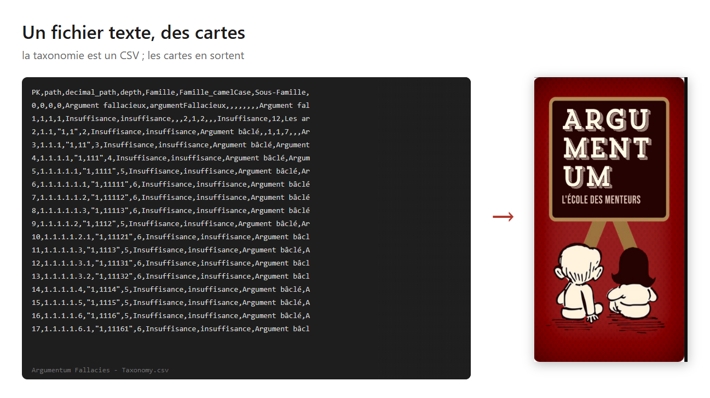

*Pourquoi :* l'article raconte ce trajet (§ « Comment naît une carte »). À gauche, dix-neuf lignes réelles de la taxonomie, en-tête compris ; à droite, la carte qu'elles produisent. Le sujet se lit sans un mot de légende.
*Source :* `Cards/Fallacies/Argumentum Fallacies - Taxonomy.csv` (lignes réelles) et `rules_face_01.png` (rendu de la carte de règles) — montage.

### 1b — les chiffres du dépôt

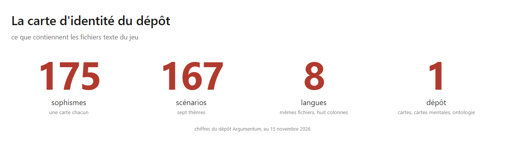

*Pourquoi :* 175 sophismes, 167 scénarios, 8 langues, 1 dépôt : quatre nombres qui disent ce qu'est devenu le projet. Variante sans capture, si l'owner préfère ne pas mêler une gravure à des chiffres.
*Source :* montage typographique ; chiffres re-mesurés au 15/11/2026 (175 = taxonomie après #1288, 167 scénarios, 8 langues).

---

## Article 2 — « Chaque sophisme à sa place : l'ontologie d'Argumentum et le format AIF »

### 2a — les liens transverses

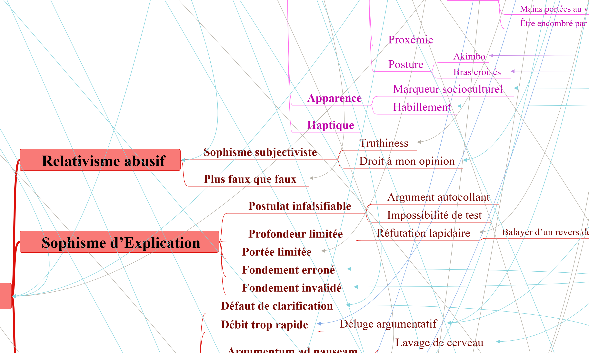

*Pourquoi :* l'article décrit « les liens transverses, tracés sur la carte » et ses 581 flèches colorées, une teinte par verbe. Ici les flèches traversent les branches au lieu de suivre l'arbre : c'est exactement ce que le texte raconte.
*Source :* `Cards/Fallacies/Mindmaps/fr/Fallacies_fr.links.svg`, recadrage ×2.

### 2b — une famille, des boucles

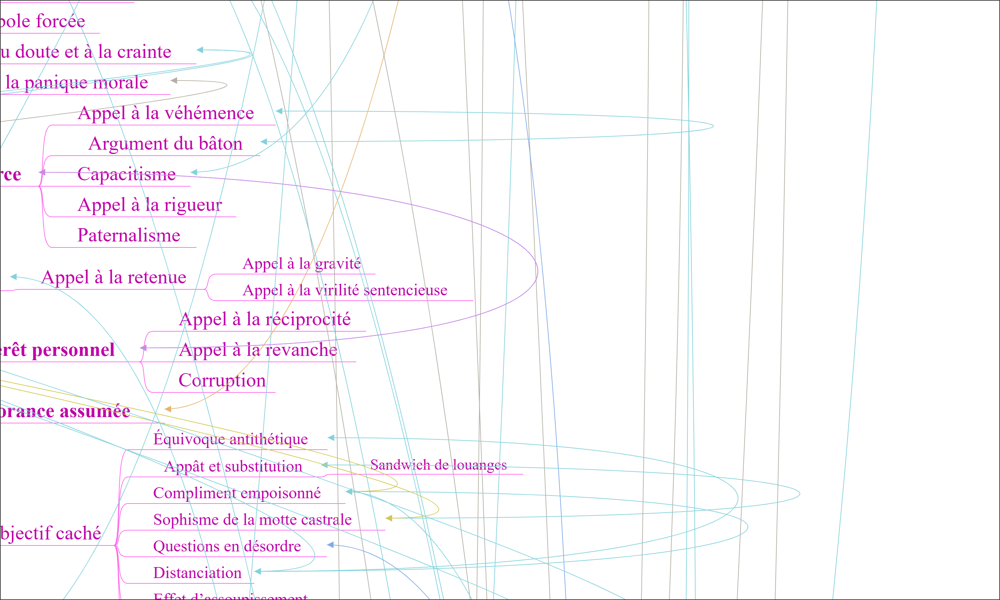

*Pourquoi :* autre détail de la même carte, où les boucles relient des branches éloignées. « Chaque sophisme à sa place » s'y voit sans lire un seul libellé.
*Source :* `Cards/Fallacies/Mindmaps/fr/Fallacies_fr.links.svg`, recadrage ×2.

### 2c — l'arborescence Explorateur

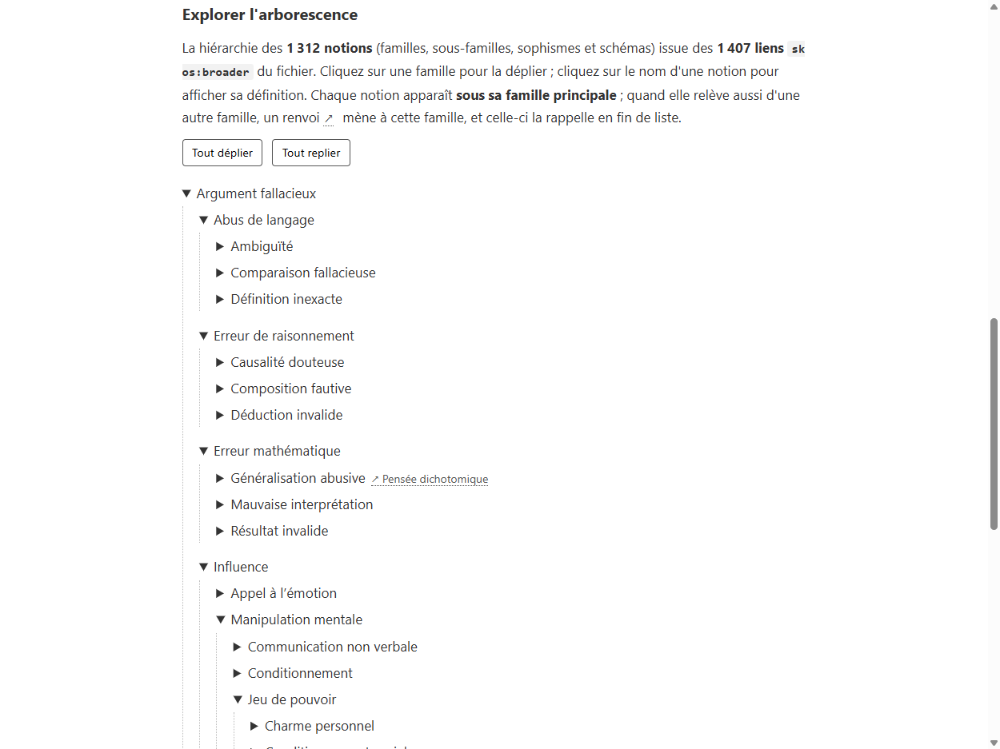

*Pourquoi :* capture de la page « Explorer l'arborescence » du site : l'ontologie telle qu'un lecteur peut la parcourir, avec le renvoi d'une notion vers une autre famille.
*Source :* capture du site, déjà au dépôt sous `docs/dnn-localization/preuves/k2-arbre-ontologie.png`.
*⚠ Réserve :* la capture affiche « 1 312 notions » là où l'article dit « 1 408 nœuds ». Ce sont deux mesures différentes, mais un lecteur peut s'y arrêter — à ne retenir que si cette confrontation ne gêne pas.

---

## Article 3 — « La descente guidée dans l'arbre : le plugin Argumentum du projet Epita »

### 3a — quatre niveaux, quatre cartes (infographie)

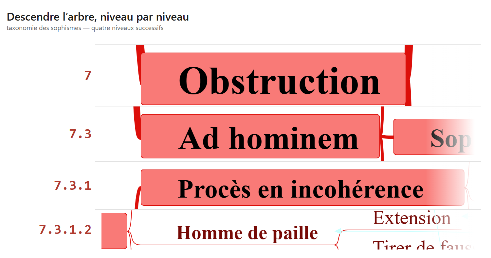

*Pourquoi :* l'article explique que le plugin descend la taxonomie niveau par niveau, « au lieu de choisir d'un coup parmi plus de mille étiquettes ». Les quatre niveaux 7 → 7.3 → 7.3.1 → 7.3.1.2 sont montrés en regard de leurs cartes respectives.
*Source :* numéros de chemin et libellés relevés sur `Cards/Fallacies/Mindmaps/fr/Fallacies_fr.content.svg` ; gravures `Cards/Fallacies/Assets/Fallacy-front/`.

### 3b — le chemin et la carte

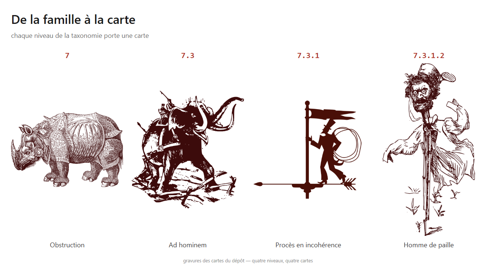

*Pourquoi :* même propos, autre forme : quatre gravures du dépôt, une par niveau, le numéro de chemin au-dessus et le nom de la carte en dessous.
*Source :* `Cards/Fallacies/Assets/Fallacy-front/7.png`, `7.3.png`, `7.3.1.png`, `7.3.1.2.png`.

---

## Article 4 — « Des carnets de cours lisent le jeu : Argumentum dans CoursIA »

### 4a — les cinq carnets

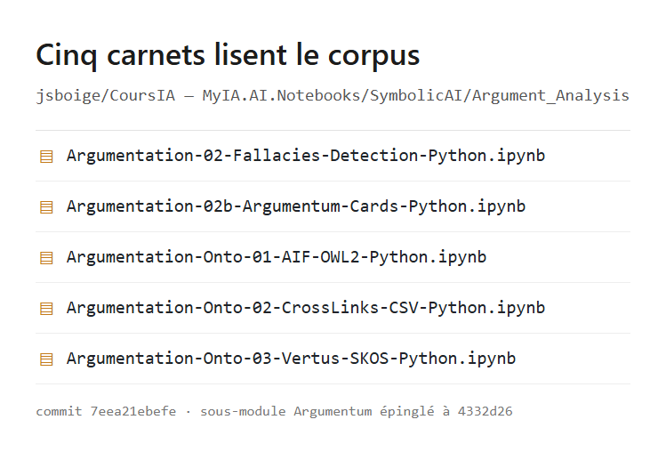

*Pourquoi :* l'article nomme cinq carnets qui consomment le corpus. Les voici nommés, dans leur dossier réel, avec le commit et l'épingle du sous-module — le sujet de l'article, en une image.
*Source :* montage typographique d'après `github.com/jsboige/CoursIA` au commit `7eea21ebefe`.

**Un seul candidat pour cet article.** Une capture de la liste de fichiers GitHub a été produite puis écartée : à 390 px elle est illisible (facteur 0,47 sur des noms de fichiers de 20 px, soit 9 px), et le premier cadrage coupait une ligne. Mieux vaut une image juste qu'une deuxième qui ne passe pas la règle de lisibilité.

---

## Article 5 — « Sophismes × scénarios : le jeu comme jeu de données »

### 5a — les sept dos de scénarios

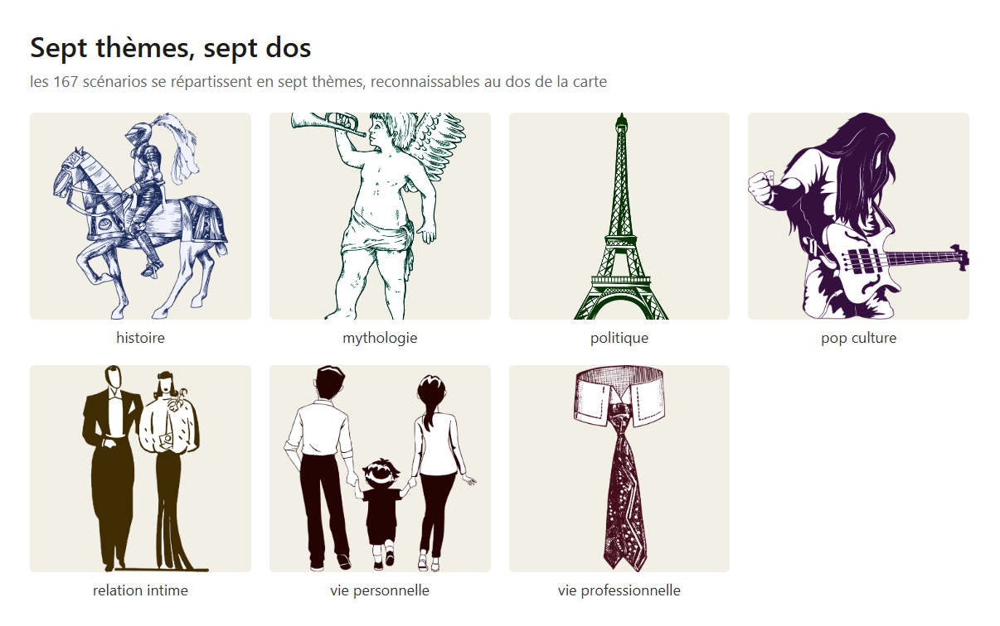

*Pourquoi :* l'article décrit un paquet tiré au hasard, en sept thèmes. Les sept dos du dépôt, avec leurs noms français.
*Source :* `Cards/Scenarii/Assets/Scenario-back/img-*.png` (sept thèmes).

### 5b — une manche, deux cartes

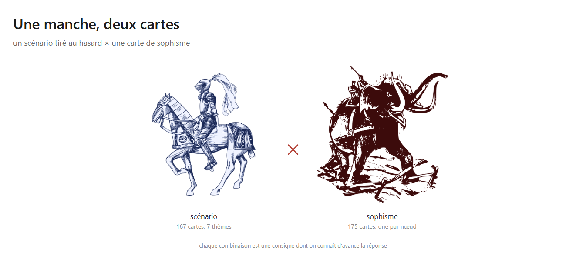

*Pourquoi :* le produit cartésien de l'article, en une image : un scénario × une carte de sophisme, et la phrase qui dit pourquoi chaque combinaison est une consigne dont la réponse est connue d'avance.
*Source :* `Cards/Scenarii/Assets/Scenario-back/img-histoire.png` et `Cards/Fallacies/Assets/Fallacy-front/7.3.png`.

---

## Article 6 — « La dette d'irréversibilité du discours : une prédiction posée sur le corpus d'Argumentum »

### 6a — les 145 arêtes d'attaque

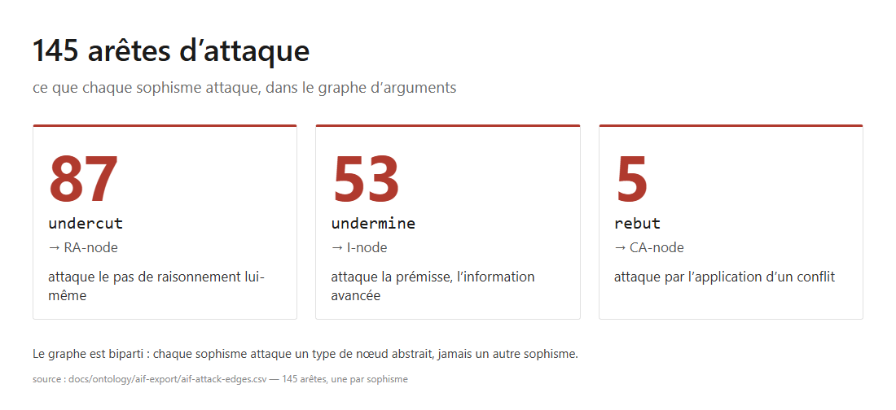

*Pourquoi :* l'article décrit un graphe où des arguments en attaquent d'autres, et précise qu'il est biparti. Les 145 arêtes du corpus, réparties selon ce qu'elles attaquent — les chiffres de l'article, mesurés sur l'export du dépôt.
*Source :* `docs/ontology/aif-export/aif-attack-edges.csv` (145 lignes ; undercut 87 → RA-node, undermine 53 → I-node, rebut 5 → CA-node).

### 6b — l'arbre, 1 408 nœuds

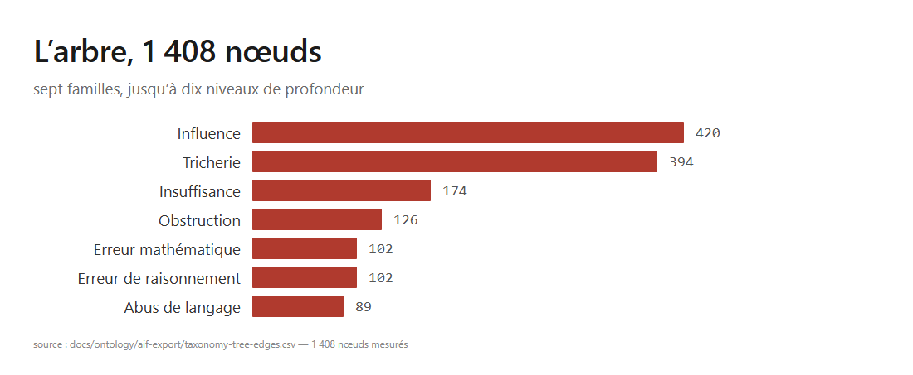

*Pourquoi :* « la matière réelle, c'est le corpus : la taxonomie des sophismes, 1 408 nœuds ». Les sept familles et leurs poids réels, en barres.
*Source :* `docs/ontology/aif-export/taxonomy-tree-edges.csv` (1 408 nœuds mesurés).

---

## Article 7 — « Le site Argumentum, en huit langues »

### 7a — le sélecteur réel

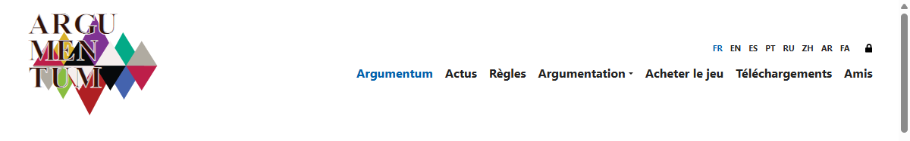

*Pourquoi :* l'article affirme que « chaque page porte le même choix de langue ». Le sélecteur du site, huit codes à la même place, pris sur la page d'accueil.
*Source :* capture de `https://dnn.argumentum.myia.io/`, 15/11/2026, sans barre d'administration ni nom de compte.

### 7b — la page d'accueil en arabe

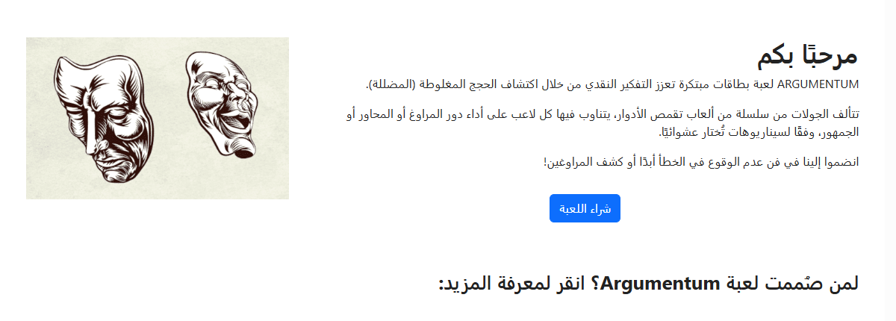

*Pourquoi :* la preuve que les huit langues sont *servies*, pas seulement listées : l'accueil complet en arabe, de droite à gauche, avec ses masques et son bouton d'achat.
*Source :* capture de `https://dnn.argumentum.myia.io/ar/`, 15/11/2026.

### 7c — les huit codes, seuls

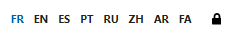

*Pourquoi :* le bandeau des huit codes, sans le reste de la page — pour un en-tête ou un pied de page, si l'owner veut un visuel plus étroit.
*Source :* capture de la même page, recadrée.

---

## Ce qui a été écarté, et pourquoi

| Image | Raison |
|---|---|
| Zoom sur un bandeau de 15 px (article 7) | agrandi huit fois, ne donne qu'une bouillie de pixels |
| Captures de la liste de fichiers GitHub (article 4) | noms de fichiers illisibles à 390 px, et premier cadrage coupant une ligne |
| Carte mentale entière réduite en vignette | ne fait plus qu'une tache — la règle de l'Epic l'exclut d'office |
| Recadrages vides de la carte des liens | aucune flèche dans le cadre : l'image ne dit rien |

**Aucune image générée n'est proposée.** Toutes viennent du dépôt, du site ou d'un montage de
ces éléments. Aucune ne place une carte de sophisme à côté d'une carte de vertu.

## Ce qui survit à la taille d'affichage

Mesuré, pas supposé — facteur de réduction et verdict :

| Image | Largeur native | Facteur liste (390 px) | Facteur article (578 px) | Verdict |
|---|---:|---:|---:|---|
| 1a | 1 297 | 0,30 | 0,45 | la carte se reconnaît ; les lignes CSV sont une texture, pas un texte à lire |
| 1b | 1 346 | 0,29 | 0,43 | les quatre nombres se lisent (104 px → 30 px) |
| 2a | 3 004 | 0,13 | 0,19 | le réseau se lit, les libellés non — image d'article plutôt que de liste |
| 2b | 3 004 | 0,13 | 0,19 | idem |
| 2c | 1 244 | 0,31 | 0,46 | l'arbre se lit, les titres de nœuds non |
| 3a | 1 500 | 0,26 | 0,39 | titre et numéros lisibles ; libellés de ligne trop petits |
| 3b | 1 346 | 0,29 | 0,43 | titre et numéros lisibles ; noms de cartes en dessous de 8 px |
| 4a | 749 | 0,52 | 0,77 | **le seul qui passe franchement aux deux tailles** |
| 5a | 1 206 | 0,32 | 0,48 | gravures lisibles, noms à la limite |
| 5b | 1 346 | 0,29 | 0,43 | titre et deux gravures lisibles |
| 6a | 1 100 | 0,35 | 0,53 | titre et trois nombres lisibles |
| 6b | 1 100 | 0,35 | 0,53 | titre et sept barres lisibles |
| 7a | 1 200 | 0,33 | 0,48 | les huit codes se devinent ; la navigation ne se lit pas |
| 7b | 1 200 | 0,33 | 0,48 | la page arabe se reconnaît à sa structure |
| 7c | 227 | 1,72 | 2,55 | bandeau : à utiliser en petit, jamais en pleine largeur |